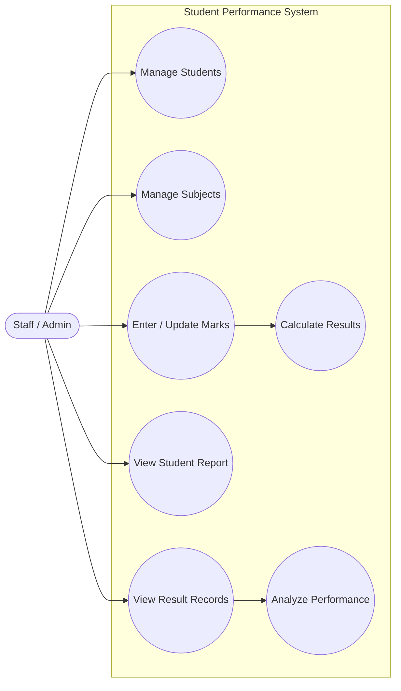
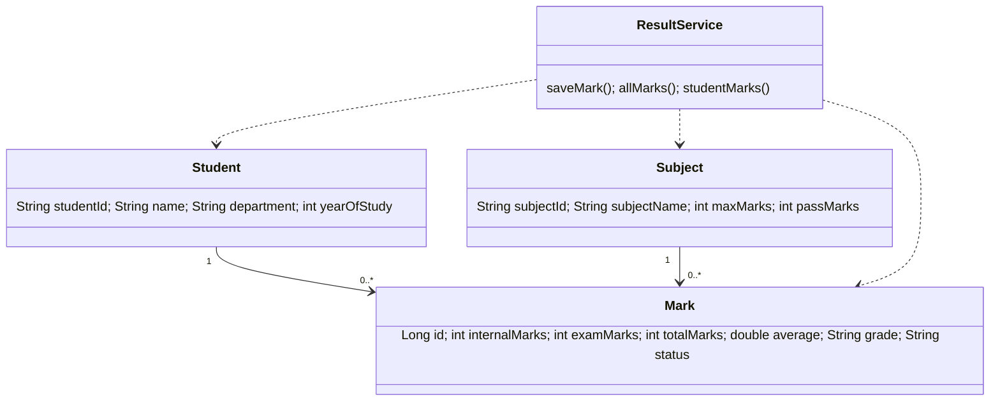
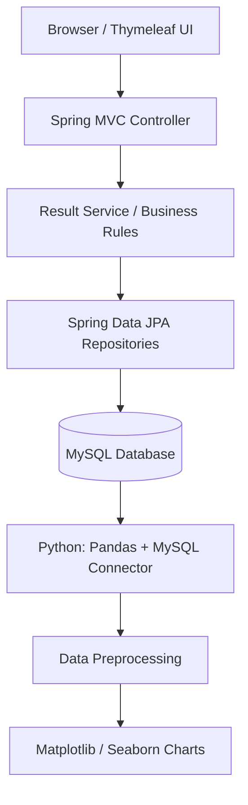

# System Design Diagrams

## Use Case Diagram


## Class Diagram


## Overall Architecture


## ER Diagram
```mermaid
erDiagram
 STUDENTS ||--o{ MARKS : receives
 SUBJECTS ||--o{ MARKS : has
 STUDENTS { varchar student_id PK; varchar name; varchar department; int year_of_study }
 SUBJECTS { varchar subject_id PK; varchar subject_name; int max_marks; int pass_marks }
 MARKS { bigint id PK; varchar student_id FK; varchar subject_id FK; int internal_marks; int exam_marks; int total_marks; double average; varchar grade; varchar status }
```

## Relational Model
- STUDENTS(**student_id**, name, department, year_of_study)
- SUBJECTS(**subject_id**, subject_name, max_marks, pass_marks)
- MARKS(**id**, student_id FK → STUDENTS.student_id, subject_id FK → SUBJECTS.subject_id, internal_marks, exam_marks, total_marks, average, grade, status); UNIQUE(student_id, subject_id).

## Normalization
- 1NF: every column stores one atomic value; no repeating subject columns.
- 2NF: each non-key attribute depends on the whole key. Student and subject details are separated from marks; MARKS uses a surrogate id and a unique student-subject pair.
- 3NF: student attributes depend only on student_id; subject attributes depend only on subject_id; mark/result attributes depend on the mark record. Student name and subject name are not redundantly stored in MARKS.
